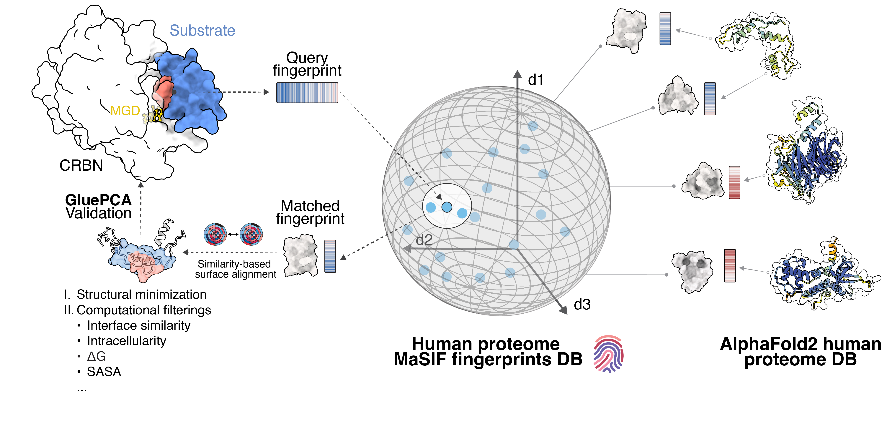

# MaSIF-mimicry

MaSIF-mimicry searches protein surfaces for patches that resemble a target interface. This repository contains the workflow used for the experiments in [*Proteome-wide identification of the druggable CRBN interactome*](https://www.nature.com/articles/s41587-026-03237-7).



> [!IMPORTANT]
> MaSIF-mimicry depends on the upstream
> [`LPDI-EPFL/masif_seed`](https://github.com/LPDI-EPFL/masif_seed.git)
> repository. MaSIF-mimicry has been tested on x86 Linux. Run
> `masif-mimicry doctor job.yaml` before starting a long job. Also verify that
> your downloaded
> neural-network checkpoint is finite; see the open
> [checkpoint reproducibility report](https://github.com/xiaosh9527/masif_mimicry/issues/3).

## Portable quick start

Choose any writable working directory. Clone the one upstream repository, then
clone MaSIF-mimicry inside it:

```bash
git clone https://github.com/LPDI-EPFL/masif_seed.git
cd masif_seed
git clone --branch v2.0 https://github.com/xiaosh9527/masif_mimicry.git

export MASIF_SEED_ROOT="$(pwd -P)"
export MIMICRY_IMAGE="$MASIF_SEED_ROOT/masif_mimicry/masif_mimicry.sif"
export PATH="$MASIF_SEED_ROOT/masif_mimicry/bin:$PATH"
```

`MASIF_SEED_ROOT` is derived from the checkout location, so the remaining
commands do not assume a username, home directory, workstation path, or HPC
filesystem layout. In a new shell, change into the `masif_seed` checkout and
set the two variables again.

The resulting layout must be:

```text
masif_seed/
├── masif/
├── masif_seed_search/
└── masif_mimicry/
```

The container is Linux `amd64`; the host options are:

| Host | Recommended runtime | Notes |
| --- | --- | --- |
| x86-64 Linux or HPC | Apptainer | Native and recommended |
| Linux workstation | Docker or Apptainer | Docker is sufficient for local testing |
| Intel macOS | Docker Desktop | Apptainer requires a Linux VM |
| Apple Silicon macOS | Docker Desktop with `linux/amd64` emulation | Use x86-64 HPC for production runs |
| Windows | Docker Desktop through WSL2 | Native Windows execution is not supported |

The same one-command interface is used on supported platforms. The launcher
selects the local SIF through Apptainer when available and otherwise uses the
published Docker image. Users do not need to write container mounts manually.

### Apptainer

Pull the published image to the checkout:

```bash
apptainer pull "$MIMICRY_IMAGE" \
  docker://ghcr.io/xiaosh9527/masif-mimicry:v2.0
```

The image contains two deliberately isolated interpreters—native Python 3.6
for MaSIF and Conda Python 3.11 for bonsai and the CLI. No host Python
environment or post-build Conda installation is required.

To build the image locally instead, build Docker first and convert a saved
archive. The archive route works even when Apptainer cannot access Docker
Desktop's daemon socket:

```bash
docker build --platform linux/amd64 \
  --tag masif-mimicry:latest \
  "$MASIF_SEED_ROOT/masif_mimicry"
docker image save \
  --output "$MASIF_SEED_ROOT/masif_mimicry/masif-mimicry-docker.tar" \
  masif-mimicry:latest
apptainer build "$MIMICRY_IMAGE" \
  "docker-archive:$MASIF_SEED_ROOT/masif_mimicry/masif-mimicry-docker.tar"
```

Verify the image and both Python runtimes:

```bash
apptainer exec "$MIMICRY_IMAGE" masif-mimicry --version
apptainer exec "$MIMICRY_IMAGE" /usr/local/bin/masif-python --version
apptainer exec "$MIMICRY_IMAGE" \
  /opt/conda/envs/bonsai/bin/python --version
```

After the human-proteome example seed has been prepared, run the included
example with one command:

```bash
masif-mimicry run \
  "$MASIF_SEED_ROOT/masif_mimicry/examples/job.container.yaml"
```

Results are written to
`$MASIF_SEED_ROOT/masif_mimicry/runs/znf692-vs-mtor/`. Check progress with:

```bash
masif-mimicry status \
  "$MASIF_SEED_ROOT/masif_mimicry/runs/znf692-vs-mtor"
```

The explicit `apptainer exec` commands below are optional diagnostics for
checking an image or troubleshooting a mount; they are not required for normal
pipeline use.

Bind the complete `masif_seed` checkout to `/workspace` and check that all
three source directories are visible:

```bash
apptainer exec --bind "$MASIF_SEED_ROOT:/workspace" "$MIMICRY_IMAGE" \
  ls /workspace/masif /workspace/masif_seed_search /workspace/masif_mimicry

apptainer exec --bind "$MASIF_SEED_ROOT:/workspace" "$MIMICRY_IMAGE" \
  masif-mimicry doctor \
  /workspace/masif_mimicry/examples/job.container.yaml
```

The SIF contains the software but not the human-proteome seed database. Before
running the example, prepare at least `P42345-F1-dom-01_A` by following
[Constructing the human-proteome seed database](#constructing-the-human-proteome-seed-database).

Then validate and preview the included mTOR-versus-ZNF692 example:

```bash
apptainer exec --bind "$MASIF_SEED_ROOT:/workspace" "$MIMICRY_IMAGE" \
  masif-mimicry validate \
  /workspace/masif_mimicry/examples/job.container.yaml

apptainer exec --bind "$MASIF_SEED_ROOT:/workspace" "$MIMICRY_IMAGE" \
  masif-mimicry plan \
  /workspace/masif_mimicry/examples/job.container.yaml
```

Equivalent manual execution for troubleshooting:

```bash
apptainer exec --bind "$MASIF_SEED_ROOT:/workspace" "$MIMICRY_IMAGE" \
  masif-mimicry run \
  /workspace/masif_mimicry/examples/job.container.yaml
```

Manual status inspection:

```bash
apptainer exec --bind "$MASIF_SEED_ROOT:/workspace" "$MIMICRY_IMAGE" \
  masif-mimicry status \
  /workspace/masif_mimicry/runs/znf692-vs-mtor
```

To create a new experiment instead of using the included example:

```bash
apptainer exec --bind "$MASIF_SEED_ROOT:/workspace" "$MIMICRY_IMAGE" \
  masif-mimicry init /workspace/masif_mimicry/my-screen
```

Put the target PDB in `masif_mimicry/my-screen/inputs/`, edit `job.yaml`, then
repeat `validate`, `doctor`, `plan`, and `run` using its container path.

Validate downloaded TensorFlow weights before a large run:

```bash
apptainer exec --bind "$MASIF_SEED_ROOT:/workspace" "$MIMICRY_IMAGE" \
  masif-mimicry checkpoint /workspace/masif/data/.../model
```

For Slurm, the default is intentionally safe: it creates and validates
`submit.slurm` without submitting it. Review the file, then either run `sbatch`
yourself or set `runtime.submit: true`.

### Docker workstation equivalent

On a workstation without Apptainer, ensure Docker Desktop is running and use
the same launcher command shown above. It automatically uses this image:

```text
ghcr.io/xiaosh9527/masif-mimicry:v2.0
```

Override it when necessary with `MIMICRY_DOCKER_IMAGE`. The following explicit
Docker commands are optional diagnostics equivalent to what the launcher does:

```bash
docker pull --platform linux/amd64 \
  ghcr.io/xiaosh9527/masif-mimicry:v2.0

docker run --rm --platform linux/amd64 \
  --volume "$MASIF_SEED_ROOT:/workspace" \
  ghcr.io/xiaosh9527/masif-mimicry:v2.0 \
  masif-mimicry doctor \
  /workspace/masif_mimicry/examples/job.container.yaml

docker run --rm --platform linux/amd64 \
  --volume "$MASIF_SEED_ROOT:/workspace" \
  ghcr.io/xiaosh9527/masif-mimicry:v2.0 \
  masif-mimicry run \
  /workspace/masif_mimicry/examples/job.container.yaml
```

Docker Desktop users must allow file sharing for the directory containing
`MASIF_SEED_ROOT`. Outputs are written through the bind mount and remain on the
host after the container exits.

For development outside the image, the lightweight CLI can still be installed
on the host. This is optional and is not part of the production runtime:

```bash
python -m pip install -e '.[dev]'
```

## One configuration file

The interface replaces editable shell scripts with a validated YAML job:

```yaml
name: znf692-vs-mtor

target:
  structure: inputs/6h0g.pdb
  pdb_id: 6h0g
  query_chain: C
  receptor_chain: B
  focus: {residue: 423, atom: CA}
  ligand: B:Y70

database:
  name: masif_human_proteome
  proteins: [P42345-F1-dom-01_A]

search:
  preset: balanced
  count_clashes: true

postprocessing:
  enabled: true
  truncation_length: 86

runtime:
  backend: local
  suite_root: /workspace
  submit: false
  slurm:
    cpus: 4
    memory: 24G
    time: "24:00:00"

output_root: runs
```

Paths are resolved relative to the YAML file. When the CLI runs inside the
container, use `backend: local` and `/workspace` as `suite_root`. The local
backend means “already inside the image”; it does not combine the two Python
environments.

## Python compatibility

The image has exactly two Python runtimes:

| Path | Version | Used for |
| --- | --- | --- |
| `/usr/local/bin/masif-python` | 3.6 | Surface preparation, TensorFlow 1.12, MaSIF search |
| `/opt/conda/envs/bonsai/bin/python` | 3.11 | CLI, RDKit, postprocessing, EvoEF2 orchestration |

Generated workflows call these absolute paths. They never run `conda activate`,
and Miniconda is deliberately not added to the global `PATH`. Environment
variables `MASIF_PYTHON` and `BONSAI_PYTHON` provide equivalent explicit paths
for the legacy scripts.

## Search presets

| Preset | Downsample | Descriptor cutoff | Mimicry-score cutoff | Intended use |
| --- | ---: | ---: | ---: | --- |
| `fast` | 5 | 1.5 | 0.45 | Quick exploratory screen |
| `balanced` | 3 | 2.0 | 0.40 | Recommended starting point |
| `sensitive` | 1 | 2.0 | 0.35 | More candidates and more computation |

Individual values can override a preset:

```yaml
search:
  preset: balanced
  downsample: 2
  descriptor_distance_cutoff: 1.8
  mimicry_score_cutoff: 0.42
```

## Runtime backends

- `local` runs directly in the current environment and is the normal choice when the CLI is already running inside the image.
- `apptainer` runs the workflow in the configured image and mounts the suite at `/workspace`.
- `slurm` generates a reproducible Slurm submission script which runs the Apptainer backend.

Large databases are expected to be preprocessed. Each value in
`database.proteins` is a processed MaSIF identifier such as
`P42345-F1-dom-01_A`. For a proteome-wide scan, use a manifest file and a Slurm
array as described below instead of placing thousands of values in YAML.

## Proteome-wide Slurm array scans

The array mode divides one ordered protein manifest into deterministic,
round-robin shards. Each task writes directly to `results/<protein-id>/` and
records a completion marker, so interrupted scans can resume without repeating
successful work. The large database remains outside Git and the SIF.

Start from [`examples/job.slurm-array.yaml`](examples/job.slurm-array.yaml) and
replace its placeholder paths with storage visible from both the login node
and compute nodes. If a database path is a symbolic link to external storage,
list its resolved storage root under `runtime.binds`.

> **EPFL/LPDI users:** cluster-specific paths, the internal database bind,
> locale setup, and the ready-to-use configuration are documented separately
> in the [EPFL HPC note](docs/EPFL_HPC.md).

For the portable one-command interface:

```bash
cd /path/to/masif_seed
export MASIF_SEED_ROOT="$(pwd -P)"
export PATH="$MASIF_SEED_ROOT/masif_mimicry/bin:$PATH"

masif-mimicry run \
  "$MASIF_SEED_ROOT/masif_mimicry/examples/job.slurm-array.yaml"
```

The launcher handles Apptainer mounts, deterministic sharding, Slurm-script
generation, validation, and `sbatch`. No host Python environment or manual
`apptainer exec` command is required. Useful follow-up commands are:

```bash
# Prepare without submitting.
masif-mimicry run --dry-run path/to/job.yaml

# Show completed array shards.
masif-mimicry status path/to/run-directory

# Resume an interrupted scan; completed shards are skipped.
masif-mimicry run path/to/job.yaml
```

`array_tasks` controls the number of deterministic shards, while
`array_max_parallel` optionally limits how many may run simultaneously.
Postprocessing must remain disabled for the array scan and can be run later on
selected hits.

## Constructing the human-proteome seed database

The human-proteome seed database is generated data; it is not a second
upstream repository and it is not included in this repository. Its default
location is inside the upstream checkout, parallel to MaSIF's other datasets:

```text
masif_seed/
├── masif/
│   └── data/
│       └── masif_human_proteome/   # generated seed database
├── masif_seed_search/
└── masif_mimicry/
```

This matches the default YAML setting:

```yaml
database:
  name: masif_human_proteome
```

With `runtime.suite_root: /workspace`, the container resolves that database to
`/workspace/masif/data/masif_human_proteome`. On the host, following the quick
start above, that is
`$MASIF_SEED_ROOT/masif/data/masif_human_proteome`.

The construction examples below use Apptainer, which is the recommended
proteome-scale runtime. On a Docker workstation, the equivalent container
prefix is:

```bash
docker run --rm --platform linux/amd64 \
  --volume "$MASIF_SEED_ROOT:/workspace" \
  ghcr.io/xiaosh9527/masif-mimicry:v2.0
```

Append the same command and arguments shown after `"$MIMICRY_IMAGE"` in each
Apptainer example. Because both runtimes mount the suite at `/workspace`, no
job paths or configuration values need to change.

### 1. Create the database and install the domain splitter

Run this on the host from the `masif_seed` directory:

```bash
: "${MASIF_SEED_ROOT:?Set MASIF_SEED_ROOT as shown in Portable quick start}"
cd "$MASIF_SEED_ROOT"
mkdir -p masif/data/masif_human_proteome
git clone https://github.com/tristanic/pae_to_domains.git \
  masif/data/masif_human_proteome/pae_to_domains
```

### 2. Split AlphaFold models into domains

Create `masif/data/masif_human_proteome/human-uniprot-ids.txt` with one human
UniProt accession per line. For the current UniProt human reference proteome
(`UP000005640`), the accession column can be downloaded with:

```bash
curl -L \
  'https://rest.uniprot.org/uniprotkb/stream?compressed=false&format=tsv&fields=accession&query=proteome%3AUP000005640' \
  | tail -n +2 \
  > masif/data/masif_human_proteome/human-uniprot-ids.txt
```

UniProt and AlphaFold DB releases evolve independently, so retain this input
list with the resulting database and review any accessions for which AlphaFold
downloads fail. For a one-protein smoke test, create the list with only mTOR:

```bash
printf 'P42345\n' \
  > masif/data/masif_human_proteome/human-uniprot-ids.txt
```

The following command downloads each AlphaFold model and its predicted aligned
error (PAE), splits it at the configured 15 Å PAE cutoff, removes low-confidence
terminal loops, and writes domain PDBs under `input/fragments/`:

```bash
: "${MASIF_SEED_ROOT:?Set MASIF_SEED_ROOT as shown in Portable quick start}"
: "${MIMICRY_IMAGE:?Set MIMICRY_IMAGE as shown in Portable quick start}"
cd "$MASIF_SEED_ROOT"

apptainer exec --bind "$MASIF_SEED_ROOT:/workspace" "$MIMICRY_IMAGE" bash -lc '
    cd /workspace/masif/data/masif_human_proteome
    set -euo pipefail
    while IFS= read -r uniprot_id; do
      [[ -z "$uniprot_id" || "$uniprot_id" == \#* ]] && continue
      bash /workspace/masif_mimicry/scripts/process_af_model.sh "$uniprot_id"
    done < human-uniprot-ids.txt
  '
```

`scripts/domain_split.py` currently downloads AlphaFold Database version 6.
The published study used version 4. For exact paper reproduction, download the
[AlphaFold human-proteome v4 archive](https://ftp.ebi.ac.uk/pub/databases/alphafold/v4/UP000005640_9606_HUMAN_v4.tar)
and adapt the input stage to use those archived structures and PAE files rather
than the current per-accession downloader. The current downloader requests only
the `F1` model for each accession. AlphaFold supplies additional `F2`, `F3`, and
later overlapping models for some very long human proteins; import those
fragments separately if the database must cover their full sequences.

### 3. Build MaSIF surfaces, predictions, and descriptors

First test one generated domain:

```bash
: "${MASIF_SEED_ROOT:?Set MASIF_SEED_ROOT as shown in Portable quick start}"
: "${MIMICRY_IMAGE:?Set MIMICRY_IMAGE as shown in Portable quick start}"
cd "$MASIF_SEED_ROOT"

apptainer exec --bind "$MASIF_SEED_ROOT:/workspace" "$MIMICRY_IMAGE" bash -lc '
    cd /workspace/masif/data/masif_human_proteome
    bash /workspace/masif_mimicry/preprocess_pdb.sh \
      input/fragments/P42345-F1-dom-01.pdb \
      P42345-F1-dom-01_A \
      -o /workspace/masif/data/masif_human_proteome
  '
```

AlphaFold models use chain `A`, so the processed identifier is the fragment
name plus `_A`. Use exactly that identifier in `database.proteins`.

After the smoke test succeeds, process every generated domain sequentially:

```bash
: "${MASIF_SEED_ROOT:?Set MASIF_SEED_ROOT as shown in Portable quick start}"
: "${MIMICRY_IMAGE:?Set MIMICRY_IMAGE as shown in Portable quick start}"
cd "$MASIF_SEED_ROOT"

apptainer exec --bind "$MASIF_SEED_ROOT:/workspace" "$MIMICRY_IMAGE" bash -lc '
    cd /workspace/masif/data/masif_human_proteome
    set -euo pipefail
    for fragment in input/fragments/*.pdb; do
      fragment_id=${fragment##*/}
      fragment_id=${fragment_id%.pdb}
      bash /workspace/masif_mimicry/preprocess_pdb.sh \
        "$fragment" "${fragment_id}_A" \
        -o /workspace/masif/data/masif_human_proteome
    done
  '
```

For each domain, `preprocess_pdb.sh` triangulates the surface, computes the
MaSIF-site and MaSIF-search inputs, predicts interface scores, and computes the
surface descriptors used by the mimicry search. The complete human proteome
requires several terabytes and should be split into parallel cluster or Slurm
array jobs rather than processed with the sequential loop above. Do not run two
jobs for the same fragment at the same time.

When construction is complete, list the processed identifiers you want to
search in the job file:

```yaml
database:
  name: masif_human_proteome
  proteins:
    - P42345-F1-dom-01_A
    - P42345-F1-dom-02_A
```

Target preprocessing is cached globally under
`masif_mimicry/data/target/targets/<processed-id>`. A later run using the same
processed target ID reuses its surface features and descriptors. Each run only
contains a symlink at `data/target`, keeping older status and inspection tools
compatible without copying the target data. To deliberately rebuild a target,
delete its directory from the shared cache before starting the run.

## Run directory

Every experiment has a predictable structure:

```text
runs/<name>/
├── run.yaml             # fully resolved configuration
├── provenance.json      # interface, host, time, and backend
├── run.sh|submit.slurm  # generated execution script
├── inputs/              # seed list, or deterministic array shards and plan
├── data/target -> shared target cache
├── results/<protein-id>/ # array output structures and CSV for each protein
├── state/shards/        # successful-array-task completion markers
├── postprocess/
├── truncate-86/
├── logs/
└── report.html
```

The generated `run.yaml`, execution script, and provenance file should be archived with published results.

## Existing installations

The original scripts remain available for compatibility:

- `preprocess_pdb.sh` preprocesses an individual PDB.
- `source/masif_mimicry_search.py` runs the core search.
- `scripts/bonsai_scripts/` contains postprocessing and truncation algorithms.
- `data/template/run.slurm` is the original worked example.

New experiments should use the `masif-mimicry` command so parameters, paths, and outputs are recorded consistently.

## Development

```bash
python -m pip install -e '.[dev]'
pytest
ruff check src tests
```

The interface tests do not run the multi-gigabyte scientific pipeline. They validate configuration, parameter presets, path translation, generated execution scripts, and run metadata.

## Hardware and dependencies

Surface preprocessing invokes external tools including MSMS, APBS, PDB2PQR,
Reduce, and USalign. Search uses the image's native Python 3.6 environment.
Bonsai uses the embedded Conda Python 3.11 environment together with EvoEF2,
STRIDE, and the bundled DeepTMHMM predictions.

APBS surface-charge calculation is the main preprocessing bottleneck. A distributed CPU cluster is recommended for proteome-scale preprocessing; a single prepared protein can be used for the included example.

## License and citation

Original MaSIF-mimicry code is released under the [MIT License](LICENSE).

MaSIF-mimicry builds on [MaSIF](https://github.com/LPDI-EPFL/masif) and [MaSIF-seed](https://github.com/LPDI-EPFL/masif_seed), which are licensed under the Apache License 2.0. Portions adapted from those projects remain under Apache 2.0; see the [third-party notices](THIRD_PARTY_NOTICES.md) and the included [Apache License 2.0](LICENSES/Apache-2.0.txt). Other third-party dependencies retain their respective licenses.

If you use MaSIF-mimicry, cite [*Proteome-wide identification of the druggable CRBN interactome*](https://www.nature.com/articles/s41587-026-03237-7).
