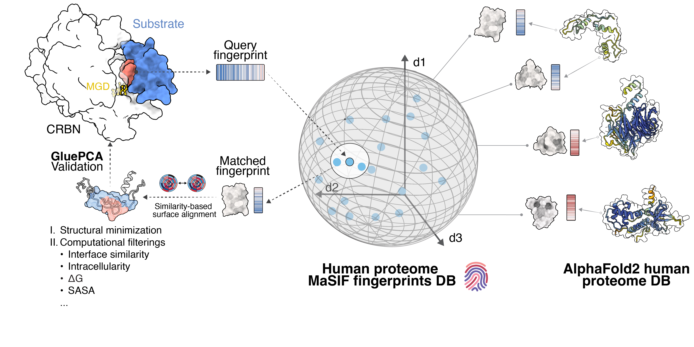

# MaSIF-mimicry

MaSIF-mimicry searches protein surfaces for patches that resemble a target interface. This repository contains the workflow used for the experiments in [*Proteome-wide identification of the druggable CRBN interactome*](https://www.nature.com/articles/s41587-026-03237-7).



## Get started

The everyday workflow is simple: choose a job file, run it, and check the results.
The launcher handles container mounts and, for cluster jobs, generates the Slurm
script for you.

### 1. Set up once

Follow the [installation guide](docs/USER_GUIDE.md#portable-quick-start) to set up
the checkout and container. Use Apptainer on an x86 Linux cluster or Docker on a
workstation. No host Python environment is needed for the launcher.

You also need a prepared seed database: it is **not included in the container**.
Use an existing lab database, or follow the
[database preparation guide](docs/USER_GUIDE.md#constructing-the-human-proteome-seed-database).
EPFL/LPDI users can use the [site-specific setup](docs/EPFL_HPC.md).

### 2. Run your job

Once setup is complete, run a configured job with:

```bash
masif-mimicry run path/to/job.yaml
```

Start from the [local example](examples/job.container.yaml) or the
[cluster example](examples/job.slurm-array.yaml). The
[configuration guide](docs/USER_GUIDE.md#one-configuration-file) explains how to
set your target, database, and output location.

For cluster jobs, set `runtime.submit: true` when ready to submit. Omitted or
false means prepare only; `--dry-run` always prevents submission. No manual
`sbatch` or container command is needed for the normal launcher workflow.

### 3. Check progress and results

```bash
masif-mimicry status path/to/run-directory
```

Find outputs in the run directory selected by your job file. See
[results and run files](docs/USER_GUIDE.md#run-directory) for the layout.
For interrupted Slurm array scans, repeat the same run command; completed shards
are skipped.

## Need more detail?

| Task | Guide |
| --- | --- |
| Install, use Docker, or troubleshoot container paths | [Setup and first run](docs/USER_GUIDE.md#portable-quick-start) |
| Configure a job | [Job configuration](docs/USER_GUIDE.md#one-configuration-file) |
| Run or resume a cluster scan | [Slurm arrays](docs/USER_GUIDE.md#proteome-wide-slurm-array-scans) |
| Prepare the seed database | [Database preparation](docs/USER_GUIDE.md#constructing-the-human-proteome-seed-database) |
| Work on the code | [Development](docs/USER_GUIDE.md#development) |

## License and citation

Original MaSIF-mimicry code is released under the [MIT License](LICENSE).

MaSIF-mimicry builds on [MaSIF](https://github.com/LPDI-EPFL/masif) and [MaSIF-seed](https://github.com/LPDI-EPFL/masif_seed), which are licensed under the Apache License 2.0. Portions adapted from those projects remain under Apache 2.0; see the [third-party notices](THIRD_PARTY_NOTICES.md) and the included [Apache License 2.0](LICENSES/Apache-2.0.txt). Other third-party dependencies retain their respective licenses.

If you use MaSIF-mimicry, cite [*Proteome-wide identification of the druggable CRBN interactome*](https://www.nature.com/articles/s41587-026-03237-7).
